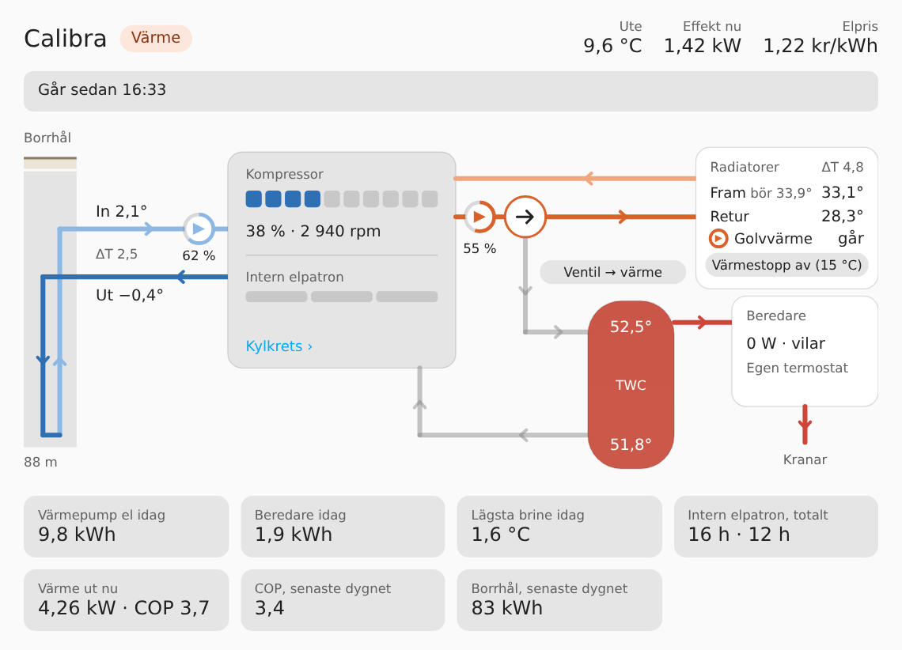
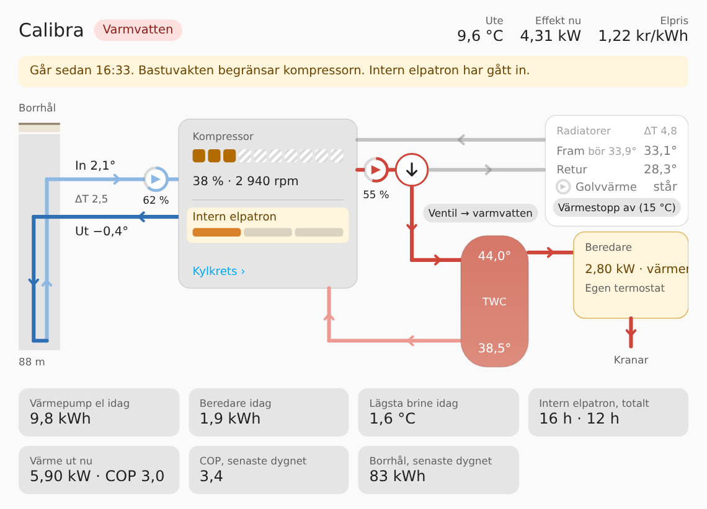
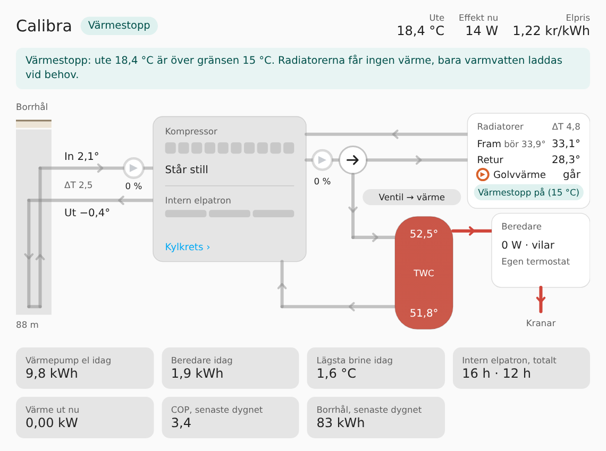
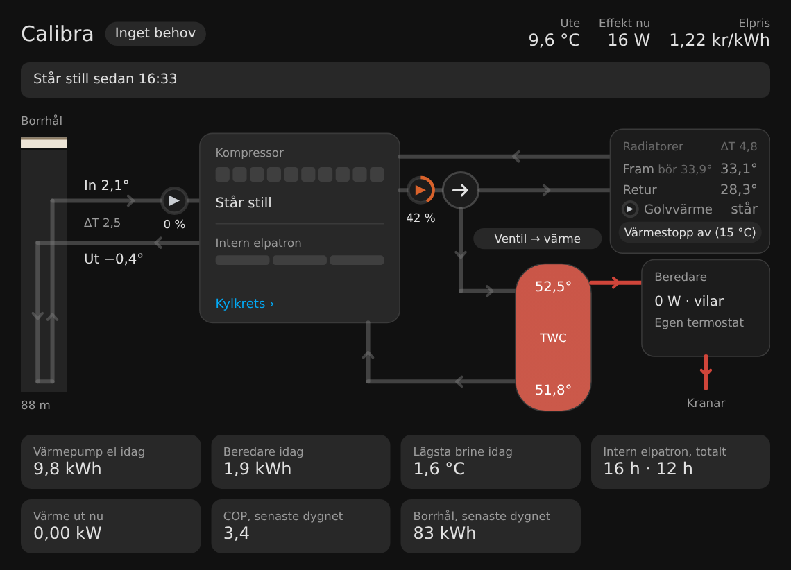
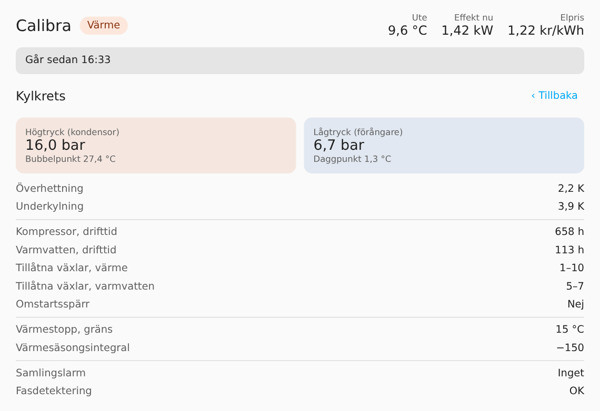
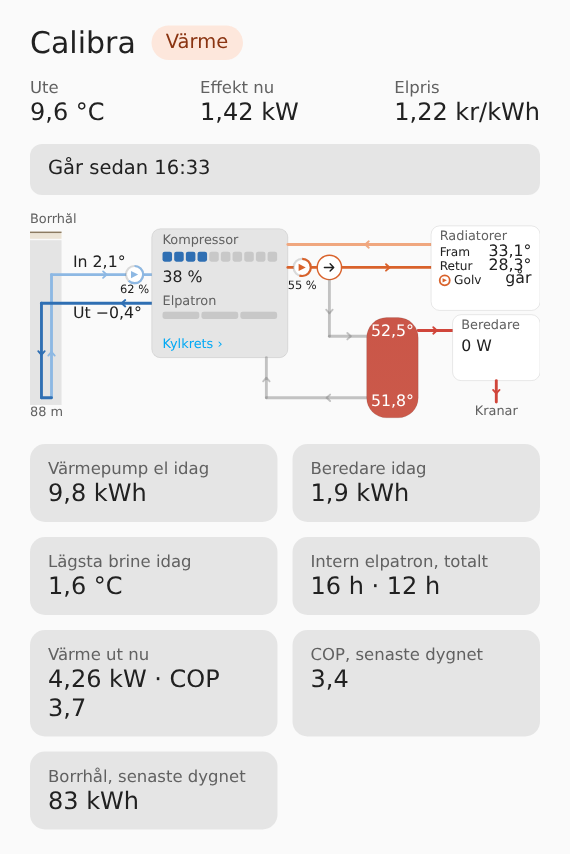
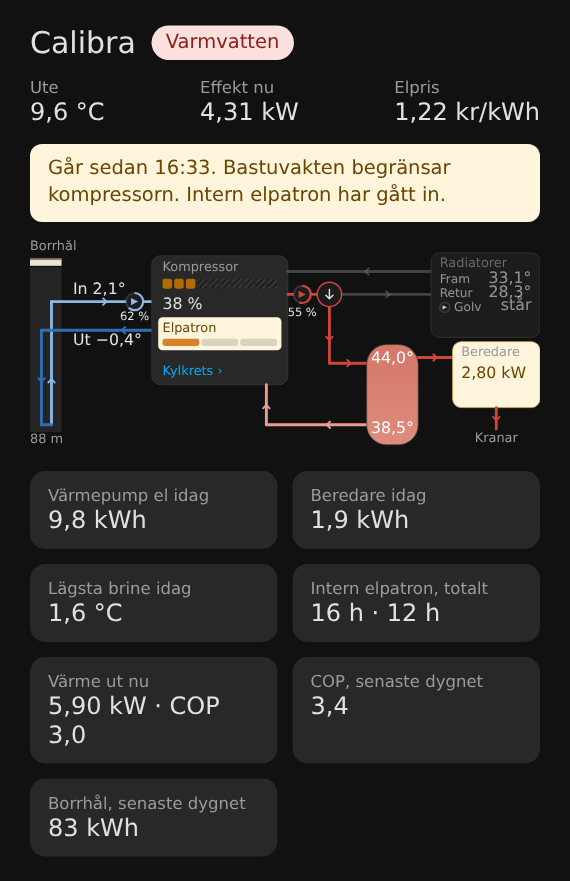
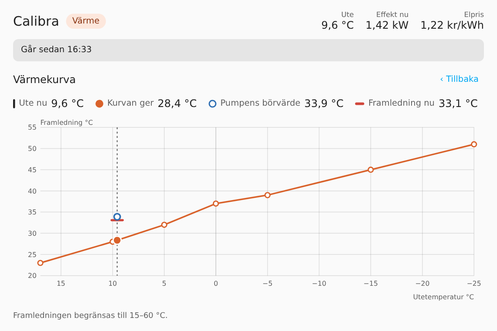

# Calibra Card

A Lovelace card for a **Thermia Calibra / Diplomat Inverter** ground source heat pump, read locally over Modbus with the [thermiagenesis](https://github.com/JanJoh/thermiagenesis) integration.

It draws the system as it is actually plumbed:

- **Borehole:** brine in and out, ΔT, and the depth.
- **Compressor:** current gear against the allowed maximum (blocked gears are hatched) and speed.
- **Pumps:** the brine pump on the brine line and the condenser pump on the supply, each drawn as a pump whose ring fills with its speed. The impeller spins faster at higher speed; it stays still with reduced motion.
- **Internal immersion heater:** its active step, drawn as a bar like the gears.
- **Diverting valve:** splits the supply between the radiators and the TWC tank. The arrow turns and the inactive branch greys out.
- **Radiators:** supply (with the pump's set point for it), return, ΔT and heating stop (on/off and its limit). Tap the box for the heat curve.
- **Optional floor heating pump:** a circulation pump for a separate floor heating loop, drawn as a row in the radiator box with its own pump symbol and whether it runs.
- **TWC tank:** top and bottom temperature, coloured by temperature.
- **Optional separate water heater** in series after the tank, with its own thermostat, plus the taps.

Flow arrows show the circulation direction, and idle circuits turn grey. The chip next to the title says what the pump wants (heating, hot water, no demand, heating stop). The line under it never repeats that: it says how long the compressor has been running or stopped ("Går sedan 16:33", "Står still sedan igår 22:05") and what holds it back. It reports a limited gear, a heating stop, the restart delay after the compressor stops (minutes left), the immersion heater coming on, an alarm, or your own notices (for example a sauna load guard).

Tap the compressor for the refrigerant circuit: pressures, dew and bubble point, operating hours, allowed gears, the restart delay, the heating stop limit and the heating season integral, and alarms. Every value opens its entity's more-info dialog.

| Heating | Hot water, limited by a load guard, immersion heater on |
|---|---|
|  |  |

| Heating stop | Idle, dark theme |
|---|---|
|  |  |

**Refrigerant circuit**: tap the compressor.



**Phone:** below 560 px the card switches to a compact diagram with larger text. The immersion heater row stays visible.

| Heating | Hot water, immersion heater on, dark theme |
|---|---|
|  |  |

Swedish and English follow the user's language. The screenshots use test data from `test/preview.html`.

## Installation

HACS → ⋮ → Custom repositories → `https://github.com/JanJoh/calibra-card`, category **Dashboard**. Install **Calibra Card**, then reload the browser.

## Configuration

The thermiagenesis entities (`*_diplomat_inverter_duo_*`) are used by default. Everything site specific is optional and only drawn when configured.

```yaml
type: custom:calibra-card
title: Calibra · bergvärme
borehole_depth: 88
entities:
  power: sensor.heat_pump_power             # W, shown in the header
  energy: sensor.heat_pump_energy           # kWh, "today" from statistics
  price: sensor.electricity_price
  valve: binary_sensor.hot_water_valve      # on = hot water
  heater_power: sensor.water_heater_power   # separate water heater
  heater_energy: sensor.water_heater_energy
  floor_pump: switch.floor_heating_pump              # optional floor heating circulation pump
  floor_pump_power: sensor.floor_heating_pump_power  # optional, opens on tap
  immersion: sensor.diplomat_inverter_duo_internal_additional_heater_current_step   # disabled by default in thermiagenesis
  immersion_hours:                          # from Thermia Online, for example
    - sensor.thermia_auxiliary_heater_1_operational_time
    - sensor.thermia_auxiliary_heater_2_operational_time
  alarm_classes:
    - binary_sensor.calibra_alarm_active_class_d
    - binary_sensor.calibra_alarm_active_class_e
notices:
  - entity: input_boolean.load_guard
    text: The load guard limits the compressor.
```

| Option | Description |
|---|---|
| `title` | Card title (default `Calibra`). |
| `borehole_depth` | Depth in metres, written under the borehole. |
| `entities.<key>` | Override any entity. The keys are listed in `DEFAULT_ENTITIES` at the top of `dist/calibra-card.js`. |
| `entities.valve` | Binary sensor that is `on` while the valve points to hot water. Without it the card infers the valve position from the demand. |
| `entities.immersion` | Binary sensor (`on`) or step sensor (`> 0`) for the internal immersion heater. Thermiagenesis has these entities, but they are disabled by default. |
| `entities.floor_pump` | Switch or binary sensor (`on` = running) for a floor heating circulation pump. Adds a "Golvvärme" row to the radiator box. |
| `entities.floor_pump_power` | Optional power sensor for that pump; tapping the row's value opens it. |
| `immersion_steps` | Number of immersion heater steps drawn as a bar like the compressor's gears (default `3`). |
| `immersion_step_kw` | Optional kW per step; shows the current power, e.g. "6 kW", next to the bar. |
| `notices` | A list of `{entity, state (default "on"), text}`. Each text is added to the explanation line while its entity is in that state. |

"Today" values (energy and the lowest brine temperature) come from long-term statistics and refresh every 5 minutes.

### The pump's own power, COP and set point

thermiagenesis 1.1 adds sensors for what the pump itself estimates and aims for. They are disabled by default in the integration; enable the ones you want on the device page and the card draws each one it finds. None of them needs the electric meter module.

| Key | thermiagenesis sensor | Where it shows |
|---|---|---|
| `consumed_power` | Consumed Electrical Power | "Effekt nu" in the header, when no `power` meter is configured. |
| `heat_output` | Heat Output Power | "Värme ut nu", with the live COP while the compressor runs. |
| `cop_day` | Reported COP | "COP, senaste dygnet". |
| `source_energy` | Energy From Natural Source | "Borrhål, senaste dygnet". |
| `supply_setpoint` | System Supply Line Calculated Set Point | Beside the supply temperature in the radiator box ("bör 33,9°"). |
| `superheat`, `subcooling` | Superheat Temperature, Sub Cooling Temperature | First rows of the refrigerant circuit view. |

The live COP is heat output divided by the pump's own power estimate, or by the `power` meter when the estimate isn't enabled.

Home Assistant names sensors you enable now after the device and its area, so their ids may not start with `diplomat_inverter_duo_` like the older ones. If a value doesn't appear, point its key at the id you have:

```yaml
entities:
  heat_output: sensor.boiler_room_calibra_heat_output_power
  consumed_power: sensor.boiler_room_calibra_consumed_electrical_power
```

### Heat curve

Tap the radiator box to see the pump's heat curve: its seven outdoor temperatures and the supply set point at each, with the outdoor temperature right now marked on it. The legend gives what the curve asks for at that temperature, the pump's own calculated set point (drawn separately only when it is not on the curve) and the actual supply temperature. The pump's lower and upper limits for the supply are stated under the chart.



The curve's entities are disabled by default in thermiagenesis: seven sensors (Heat Curve X Coordinate 1–7) and seven numbers (Set Point Heat Curve Y 1–7), plus Min Limitation and Max Limitation. Enable them on the device page. Until at least two points are readable the radiator box is not a button and nothing changes.

The card only reads them. The set points are writable numbers in Home Assistant, so the chart's points deliberately open nothing: changing the curve is done on the pump or on the device page, not by a stray tap.

As with the sensors above, ids you enable now may not start with `diplomat_inverter_duo_`. Then list them, warmest point first or in any order:

```yaml
entities:
  curve_x:
    - sensor.boiler_room_calibra_heat_curve_x_coordinate_1
    # … through 7
  curve_y:
    - number.boiler_room_calibra_set_point_heat_curve_y_1
    # … through 7
  curve_min: number.boiler_room_calibra_min_limitation
  curve_max: number.boiler_room_calibra_max_limitation
```

### Hot water tank

Tap the tank in the diagram to see its top and bottom temperatures as two curves over 1, 3 or 7 days (`tank_hours` sets the default, 72), with the tap water start and stop temperatures (`tap_start`, `tap_stop`) as dashed lines. Legionella cycles (the demand sensor's "Anti legionella") are shaded, with the last run and roughly when the next is due. Tap a value in the legend for its more-info dialog.

## Energy signature card

`custom:calibra-signature-card`, in the same file, compares the heat pump's daily electricity use against the daily mean outdoor temperature across periods, for example before and after replacing the pump. It reads hourly long-term statistics from the recorder, keeps only complete days, and draws:
- one series per period;
- a fitted curve per period;
- the value at a reference temperature, used as the finding.

```yaml
type: custom:calibra-signature-card
title: Gammal mot ny värmepump
energy: sensor.heat_pump_energy                            # kWh, total_increasing
temperature:                                               # °C, measurement: one entity or a list
  - sensor.netatmo_outdoor_temperature
  - sensor.outdoor_temperature_backup
start: "2025-10-01"
reference: 5                                               # °C, or an entity to follow, e.g. sensor.outdoor_temperature
periods:
  - name: Gammal pump
    end: "2026-06-15"
  - name: Ny pump
    start: "2026-09-25"
exclude:                                                   # optional, dropped from every period
  - start: "2026-01-01"
    end: "2026-03-01"
```

A day counts when it has 24 hours of energy and at least 20 hours of temperature. With a list under `temperature`, each hour takes the first sensor that has a value, so an outage in the main sensor is filled from the next one instead of losing the day. `exclude` leaves out date ranges with bad data (start inclusive, end exclusive, like the periods).

The last period is drawn as the highlighted one. A curve's value at the reference temperature is shown only when that period has data on both sides of it.

The reference is where the dashed line sits and the finding is read:
- A number is a fixed temperature (default 5 °C).
- An entity id (`reference: sensor.outdoor_temperature`) follows that sensor, rounded to half a degree, so the card compares the periods at today's weather. `reference_fallback` (default 5) is used while the sensor has no value.
- The difference between the newest and the first period at that temperature is shown above the line, next to it.
- Drag in the chart, tap it, or focus it and use the left and right arrow keys to read the curves at another temperature. "Tillbaka till …" returns to the configured reference; reloading the page does too.

## Development

```sh
node --test test/*.test.js
# screenshots of test/preview.html
docker run --rm -v "$PWD":/w -w /w mcr.microsoft.com/playwright:v1.49.1-noble \
  sh -c 'cd /tmp && npm i -s playwright@1.49.1 >/dev/null; cd /w && NODE_PATH=/tmp/node_modules node test/shots.js'
```

MIT License.
